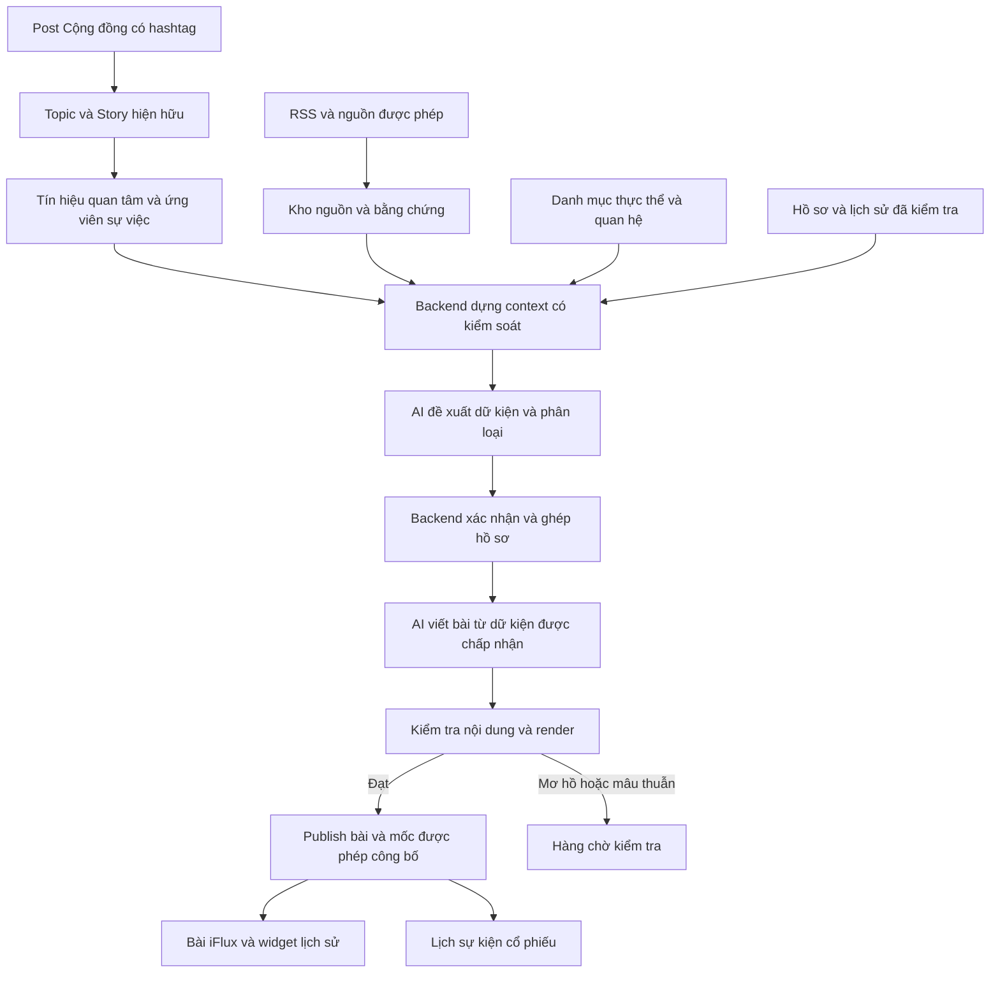

# iFlux — Kế hoạch tổng thể AI biên tập tin, sự kiện và tín hiệu Cộng đồng

> **Cập nhật 2026-10-16:** phần khảo sát/kế hoạch P0 bên dưới được giữ để truy vết thời điểm ban đầu. Trạng thái triển khai hiện tại, kết quả kiểm thử và các gap bắt buộc xem [AI-News-Integration.md](./AI-News-Integration.md); prompt chính thức không còn ở file riêng — Admin sửa trực tiếp trong DB tại Admin → Thiết lập SEO → AI Programmatic SEO. Các câu “chưa triển khai/chưa có provider” trong bản P0 không phải trạng thái mới nhất. Đã bổ sung article/UI/SEO/events/comparison, AI preview, và auto-publish có điều kiện (Owner bật/tắt tại Admin, chỉ publish khi output qua hết kiểm tra nội dung). So sánh theo cơ chế chính thức: AI chọn **một scope ngành/hệ sinh thái/Story**, metric thông tin doanh nghiệp được hỗ trợ, backend đọc DB canonical. Không có kho financial metrics riêng; P/E/P/B/Room NN chưa bật adapter. Thứ tự related hiện tại: thực thể → Story → danh mục. RSS không được đăng ký index, không vào sitemap, luôn noindex; không phải gửi rồi chờ Google quyết định.

Ngày: 2026-10-13. Trạng thái: khảo sát source + đề xuất kế hoạch; CHƯA triển khai.

## 1. Overview

### Task Objective
Tự động biến tin nguồn thành bài chính thức iFlux có dữ kiện đúng, liên kết thực thể đúng, diễn biến sự việc, nhận định có căn cứ và bài liên quan. Dùng Topic/Story từ Cộng đồng để phát hiện nhu cầu và ưu tiên biên tập; sự kiện có bằng chứng được ghi vào bài và Lịch sự kiện của thực thể. Tin trùng bổ sung nguồn, diễn biến mới nối hồ sơ hiện hữu. Không tự deploy production.

### Task Roadmap
| Phase | Objective đóng góp vào Task Complete |
| --- | --- |
| P0 — Context và kế hoạch | Xác định khả năng hiện hữu, lỗi, gap và hướng tổng thể |
| P1 — Nền tảng đúng | Vá formation/thống kê/Story, nhận diện thực thể và chốt contract |
| P2 — Dữ liệu có bằng chứng | Nguồn, hồ sơ, mốc, liên kết Cộng đồng, chống trùng và API lịch sử |
| P3 — Biên tập và UI bằng dữ liệu thử | Context builder, render, review và Lịch sự kiện chạy bằng fixture/mock |
| P4 — GPT‑5.4 dry-run | Tích hợp model thật, đo chất lượng/chi phí, không publish |
| P5 — Kiểm chứng staging | Thử publish nhất quán, retry, lỗi, quyền truy cập, desktop/mobile |
| P6 — Bàn giao | Evidence, cấu hình, mẫu vào/ra, vận hành và giới hạn; production theo quyết định riêng |

### Current Phase Objective
P0: trả lời Topic/Story đã tự hình thành đến đâu, context còn thiếu gì; đóng gói kế hoạch tổng thể trước khi tài khoản AI sẵn sàng. Tài liệu này không phải lệnh triển khai P1.

### Phase Contribution
P0 → thống nhất việc cần sửa/tái dùng/bổ sung → mở thiết kế contract và từng slice độc lập. Chưa được coi source tồn tại là tính năng đã hoạt động trên staging. Exit preview: inventory, rule hiện tại, lỗi có evidence, backlog backend/frontend và tiêu chí nghiệm thu.

## 2. Objective
Cho Claude/Codex tiếp tục từ cùng một mô hình nghiệp vụ, không dựng thêm pipeline RSS, Topic engine, media engine hay article renderer song song. Giữ GPT‑5.4 làm model thử nghiệm theo yêu cầu người dùng; hạ tầng dữ liệu không phụ thuộc khả năng đoán của model.

## 3. Scope
- Đọc service Topic/Story/Post, migrations 073/076/078/080, scheduler/server, queue, các điểm đọc/render bài viết và sanitizer Admin.
- Kế thừa khảo sát RSS/news/market/media/route/CI tại [AI-News-Context-Audit.md](./AI-News-Context-Audit.md).
- Lập backlog tổng thể cho dữ liệu, backend, frontend User/Admin, AI, kiểm thử và vận hành. Các phase tiếp theo chỉ lập plan thi công chi tiết khi được mở.

## 4. Evidence

### 4.1. Kết luận về tự động hình thành
**Topic: đã có cơ chế tự hình thành trong source. Story: đã có nhánh tự tạo và cron nối vào, nhưng có bất nhất schema có thể chặn nhánh này. Chưa kiểm tra DB/log để xác nhận hoạt động thật.**

| Bước | Rule hiện tại được đọc từ source |
| --- | --- |
| Post tạo Topic | `community-posts.service.js:createPost` gọi `topics.service.js:attachPostTopics` với mảng hashtags. Không có hashtag thì không tự phân cụm chủ đề từ văn bản |
| Gom biến thể | Hashtag được chuẩn hóa bỏ dấu, lowercase, bỏ khoảng trắng qua `topicSlug`; không gom theo ý nghĩa các hashtag khác từ |
| Topic ban đầu | Tạo ngay khi hashtag mới xuất hiện; giữ trạng thái tích lũy bằng `confirmed_at = NULL` |
| Topic chính thức | `usage_count >= topic_formation.confirm_usage_count`, mặc định 100. Đếm số cặp Post–Topic mới, không phải lượt xem, số tác giả duy nhất hay độ đúng thông tin |
| Cổ phiếu đại diện | Lấy stock_tags của các Post published thuộc Topic; chọn các mã theo tỷ trọng số lần xuất hiện đến khi cộng dồn đạt ít nhất 80%; chốt snapshot một lần lúc confirm |
| Thịnh hành | Topic confirmed, có cổ phiếu đại diện, engagement trong kỳ > 0; xếp giảm dần. Mặc định điểm = Like + Dislike + 3×Comment + 4×Share; không có views trong công thức |
| Mới nổi | Có gate engagement/user/recent, net reaction >= 0, rồi tính Velocity/Growth/NetReaction bằng percentile. Không phải cùng danh sách với Thịnh hành |
| Tự tạo Story | Cron gọi `autoCreateFromTopTrendingWeekly`: lấy tối đa 5 Topic Thịnh hành tuần chưa có Story, tạo Story. Cron mặc định chạy mỗi ngày; cửa sổ ranking là tuần, không phải cron chạy mỗi tuần |
| Nội dung Story tự tạo | Title = tên Topic; stock_tags = snapshot; description = rỗng; sentiment mặc định `bullish`; auto_created = true. Chưa tổng hợp sự kiện hay bằng chứng |
| Lifecycle Story | new/rising/trending/declining/archived dựa trên engagement Topic; Admin override thắng. Đây là trạng thái quan tâm của thảo luận, không phải trạng thái hoàn tất vụ việc |
| Hết hoạt động | Topic không được nhắc 90 ngày mặc định bị DELETE; FK migration 080 kéo Story liên kết theo CASCADE |

Ngưỡng và trọng số có thể đổi qua `topic_scoring_config`; các con số trên là default source/migration, chưa xác nhận cấu hình DB đang chạy. Cron chịu cấu hình scheduler và `TOPIC_LIFECYCLE_CRON`, chưa xác nhận có bật ở runtime.

Nguồn chính: `backend/src/modules/community/topics.service.js`, `stories.service.js`, `community-posts.service.js`, `backend/src/server.js:52`, `backend/migrations/080_topic_lifecycle_v2.sql`.

### 4.2. Những gì Topic/Story cung cấp và chưa cung cấp
| Có thể tái sử dụng | Còn thiếu để viết sự kiện có căn cứ |
| --- | --- |
| ID, hashtag/tên, thời gian, mã đại diện, Post–Topic, Story–Topic, tương tác và mức quan tâm | Pháp nhân công ty con, quan hệ sở hữu đúng thời điểm, vai trò chủ thể, hồ sơ pháp lý cụ thể |
| Nội dung Post công khai đủ điều kiện và nguồn tin được người dùng chia sẻ | Bằng chứng xác nhận từng claim, phân biệt tin đồn/cáo buộc/quyết định/kết quả/đính chính |
| Ưu tiên chủ đề để theo dõi, gợi ý bài/chủ đề liên quan | Ghép nhiều nguồn, nhiều mốc, nhiều hashtag thành đúng một hồ sơ, không gom nhầm hai việc của cùng mã |

**Đủ làm tín hiệu phát hiện và context nhu cầu; chưa đủ làm bộ dữ kiện xác nhận để tự tạo mốc public.** Topic confirmed chỉ nghĩa là đủ mức sử dụng hashtag, không nghĩa là nội dung được xác minh.

### 4.3. Lỗi và rủi ro có bằng chứng
| ID / ưu tiên | Bằng chứng và phân loại | Tác động / hướng xử lý dự kiến |
| --- | --- | --- |
| G01 / P0 | `autoCreateStoryFromTopic` INSERT author_id NULL; migration 073 khai báo NOT NULL. Tìm toàn bộ migrations chưa thấy bỏ NOT NULL | Bất nhất code/schema xác nhận qua source; nếu DB theo migrations thì insert thất bại. Chốt danh tính system cho Story tự động hoặc nullable system-author có chủ đích; ưu tiên quy ước tác giả hệ thống sẵn có. Kiểm tra DB trước khi chọn migration |
| G02 / P0 | Cron daily gọi `recomputeDailyStats()`; default lấy ngày UTC hiện tại. Fixture đồng hồ 2026-10-13 00:00Z trả queriedDay=2026-10-13 | Tái hiện lựa chọn ngày vừa bắt đầu. Cần timezone thống nhất, chốt ngày vừa kết thúc, cập nhật ngày hiện tại và backfill ngày bị thiếu; kiểm chứng cả VM chạy UTC và Asia/Ho_Chi_Minh |
| G03 / P0 | `createPost` nuốt lỗi attach Topic; attach gồm insert liên kết rồi tăng usage_count qua các query rời | Có thể mất mapping hoặc lệch bộ đếm nếu lỗi giữa chừng. Dùng transaction cho dữ liệu phụ thuộc + retry/reconciliation bền vững; log có mã lỗi. Cron confirm hiện không sửa liên kết bị thiếu |
| G04 / P0 | Nhiều query thống kê/đại diện chỉ lọc published, không lọc visibility=public; stock_tags từ Post chỉ trim/uppercase/dedup | Chưa đủ làm context public an toàn/đúng danh mục. Lọc quyền trước AI, validate mã với catalog, tách metadata quan tâm khỏi thực thể xác nhận; chưa kết luận đã có rò dữ liệu thực tế |
| G05 / P1 | Stats upsert các nhóm có dữ liệu, không reset nhóm về 0 nếu sau xóa không còn row; xóa Post là soft delete | Có nguy cơ giữ stats cũ; xác minh bằng fixture DB deletion/unlike và sửa recompute có tính lặp lại |
| G06 / P0 | Story tự tạo description rỗng và sentiment mặc định bullish | Không dùng bullish làm kết luận về vụ pháp lý. Tách editorial sentiment khỏi dữ kiện/sự kiện; đề xuất nullable/unspecified cho hệ thống nếu chưa có căn cứ, đồng bộ UI/schema nếu chốt |
| G07 / P0 | Topic DELETE 90 ngày và Story CASCADE | Hồ sơ, mốc và nguồn đã xác nhận phải sống độc lập; xóa Topic chỉ gỡ liên kết/snapshot ngữ cảnh tối thiểu, không xóa lịch sử sự kiện hoặc bài iFlux |
| G08 / P0 | Resolver span lồng nhau gắn cả hai mã; đã chạy fixture Alpha/Alpha Miền Nam trong khảo sát trước | Sửa resolver hiện tại, alias xác nhận, pháp nhân/quan hệ/vai trò và review khi mơ hồ. Không chỉ chọn tên dài nếu bằng chứng còn chỉ ra hai chủ thể khác nhau |
| G09 / P0 | RSS chỉ cần title+category để published_rss, chống trùng theo URL bằng SELECT rồi INSERT | Cần source intake nội bộ, quality gate và ràng buộc idempotency DB. Không để nhánh RSS cũ đi vòng qua gate AI mới |
| G10 / P0 | `core/queue/queue.js` là in-memory shell, chỉ push pending array | Không đủ cho AI jobs/retry/restart. Mở rộng hạ tầng queue đúng owner hoặc chọn DB-backed job theo pattern media hiện có; chốt một nơi quản lý công việc |
| G11 / P0 | Admin có DOMPurify contract; RSS lưu HTML nguồn, normalizeArticleInput lưu chuỗi HTML; User Web prepareArticleBody dùng innerHTML, không sanitize ở hàm này | Sanitizer Admin không bao phủ ingest/API/AI. Cần sanitize server và renderer có contract chung, kiểm chứng toàn đường dữ liệu; chưa chạy exploit trên trình duyệt |
| G12 / P1 | Admin HTML contract chỉ cho href http(s)/mailto; link nội bộ dạng /co-phieu/... bị loại | Cần policy URL nội bộ từ route thật, đồng bộ editor/backend/User Web; không mở mọi protocol |
| G13 / P1 | updateArticle tính lại slug theo title; related feed ưu tiên category→story→ticker; eventsPanel trống | Giữ slug khi sửa title; sửa ranking; bổ sung API và UI timeline theo hồ sơ/loại hoạt động |
| G14 / P1 | Docs có nhiều thế hệ Topic/Story, comments cũ còn khác hành vi cuối ngày trong migration 080 | Cập nhật mô tả hiện hành, phân biệt source đã kiểm tra với SoT đề xuất; không coi tài liệu Product Vision mới chưa track là quyết định override tự động |

P0/P1 trong cột ưu tiên là mức ưu tiên backlog, không phải số phase.

### 4.4. Phạm vi kiểm chứng thực tế
- Đã đọc code/migration/consumer nêu trên; kiểm tra không có diff runtime trong backend/User_Web/Admin/.github ở thời điểm khảo sát.
- Đã chạy resolver bằng fixture catalog giả và hàm thống kê bằng đồng hồ giả, mock DB query; không sửa runtime và không kết nối DB.
- Chưa chứng minh cron bật, migration đã áp dụng, cấu hình live, thống kê đang đúng, Story đã được tự tạo thành công hoặc PNJ có Topic thật trên DB.
- PNJ/công ty con trong tài liệu là tình huống yêu cầu của người dùng; không khẳng định một sự kiện pháp lý cụ thể có thật.

## 5. Deliverables

### 5.1. Kiến trúc luồng đề xuất

Hai đầu vào độc lập: tin nguồn vẫn được xử lý dù chưa có Topic; Topic có thể khởi tạo ứng viên theo dõi trước khi có tin nguồn. Không bắt buộc chờ Topic đạt 100 hoặc có Story mới được xử lý sự kiện. Độ nóng điều chỉnh ưu tiên xử lý, không điều chỉnh tiêu chuẩn xác nhận.

Topic/Story → AI có thể tạo **ứng viên sự việc cần đối chiếu**. Chỉ khi có nguồn đủ căn cứ và entity hợp lệ mới ghi **mốc được công bố**. AI không tự nâng tin đồn lên dữ kiện.

### 5.2. Impact Analysis / quyết định owner (CG-005)
| Capability | Owner, file/function hiện có | Consumers / storage/API | Decision |
| --- | --- | --- | --- |
| Formation và ranking | community: topics.service.js / attachPostTopics, recomputeDailyStats, confirmTopic, getTrendingTopics; stories.service.js / autoCreateStoryFromTopic; server.js | Community widgets, admin topic list, topics/stories/post_topics/topic_daily_stats/topic_scoring_config | Modify đúng owner, giữ rule đã chốt trừ các lỗi và đề xuất cần quyết định |
| Context Cộng đồng | community-posts.service.js; topics/stories services/routes | Social Post công khai đủ quyền, metadata Topic/Story cho news orchestration | Reuse query/ID; thêm projection có lọc quyền và snapshot thời điểm, không copy toàn Cộng đồng sang kho AI |
| Thực thể | market-master.service.js; news-entity-resolve.service.js / loadMaster, resolveArticleEntities | stocks/sectors/ecosystems, article tickers/occurrences, entity links | Modify resolver; bổ sung catalog alias/pháp nhân/quan hệ nếu schema chưa có |
| Nguồn và biên tập | rss-ingest.service.js / processFeed, upsertRssArticle; news-articles.service.js / createArticle, updateArticle; news.routes.js | news_posts, Admin editor, ArticleDetail, public article | Reuse fetch/media/CRUD; modify intake/gate/idempotency, không tạo news pipeline thứ hai |
| Hồ sơ và mốc | Chưa tìm thấy owner runtime đáp ứng trong inventory | Backend news cần ghi/query; User eventsPanel và article widget cần đọc | New capability có lý do: Post/Story lưu thảo luận, không có mốc chứng cứ. Đề xuất knowledge/event domain riêng, news orchestration gọi một owner này; chốt boundary trước implementation |
| Job và AI | core/queue/queue.js; scheduler; media-trigger.worker.js làm pattern; ai/ai-notif-admin.service.js | AI prompt/log/cost/quality, review/replay, background jobs | Modify/extend một hạ tầng job; ai owner gọi model và quản trị run, news owner điều phối nghiệp vụ |
| Bài liên quan và URL | news-feed.service.js / listFeed; news-articles.service.js / ensureUniqueSlug, updateArticle; User news-store.js | /news/feed?related_to, canonical, former_slugs | Modify tại owner hiện hữu; migrate quyết định link về backend, loại heuristic trùng responsibility khi xong |
| Public UI | User_Web/iflux-web-ui/entity-detail-center.js / eventsPanel; news-post-page.js; news-store.js | Trang cổ phiếu, bài viết, link/thảo luận/related | Modify renderer, bổ sung widget theo DS/pattern; không nhân đôi shell/trang bài |
| Admin UI | danh-sach-chu-de.html → chu-de-registry-page.js / chu-de-registry-store.js; news/content/article-edit-page.js; app/ai/* | Topic/Story mapping, editor, prompt/log/cost/quality | Extend màn hiện hữu; chỉ thêm màn hồ sơ/review nếu responsibility mới chưa có |
| HTML/media/SEO | article-html-contract.js; media-import.service.js; news article route/canonical | Editor, ingest, API, desktop/mobile | Reuse contract/media, enforce server, đồng bộ safe internal links và publish gate |

File mới chỉ cho responsibility chưa có: hồ sơ/mốc, source provenance khi news_posts không đáp ứng, context contract/run/job hoặc tests cần thiết. Khi migration chuyển owner link/render, phải chuyển consumer và xóa logic quyết định cũ còn dư; không để hai bộ cùng quyết định lâu dài. Bản kế hoạch là file mới để phân biệt audit hiện trạng với đề xuất sẽ được cập nhật; không tạo implementation song song.

### 5.3. Mô hình dữ liệu cần đạt
Tên bảng dưới đây là tên khái niệm, chưa phải migration đã chốt.

| Khái niệm | Dữ liệu/quan hệ tối thiểu |
| --- | --- |
| Pháp nhân và alias | ID ổn định; tên pháp lý, thương hiệu, viết tắt, alias đã xác nhận; stock mapping; quan hệ mẹ/con/thương hiệu có nguồn và hiệu lực thời gian; không bắt công ty chưa niêm yết phải có ticker |
| Nguồn | Provider/URL gốc, ngày công bố/fetch, bản nội dung hoặc phiên bản/hash, quyền/nguồn ảnh, phân loại độ tin cậy, đoạn bằng chứng. Cùng URL đổi nội dung có version |
| Taxonomy sự kiện | 8 nhóm đúng yêu cầu; subtype dùng chung, trạng thái theo nghiệp vụ, không lấy lifecycle Story làm trạng thái pháp lý |
| Hồ sơ sự việc | ID, loại, pháp nhân chủ thể và các vai trò, số quyết định/hồ sơ/dự án hoặc người giao dịch/đợt, trạng thái, nguồn căn cứ, quan hệ hồ sơ khác khi có |
| Mốc diễn biến | case_id; entity+role; loại/trạng thái/tóm tắt; announced_at/occurred_or_effective_at/recorded_at riêng; ngày thiếu null, có độ chính xác ngày nếu cần; evidence và confidence |
| Số liệu mốc | Chủ thể, chỉ tiêu, giá trị chuẩn hóa và biểu diễn nguồn, đơn vị, kỳ, actual/planned. Số đăng ký và số thực hiện là hai trường, giữ cả hai; không biến null thành 0 |
| Đính chính | Bản sửa có người/hệ thống, lý do, thời điểm, dữ kiện trước/sau, nguồn mới; mốc cũ được đánh dấu sửa/thay thế thay vì mất lịch sử |
| Liên kết | Source–milestone; article–case/milestone; case–entity(role); case–Topic/Story nhiều-nhiều. Không đổi quan hệ Topic–Story 1:1 sẵn có chỉ để ghép sự kiện |
| AI run/job/review | Input/context hash+version, prompt/model/schema version, request/response có lọc secret, usage/cost, stage/status, attempts/lease/backoff/error, review reason, output artifact; idempotency key |

Hồ sơ/mốc không bị CASCADE theo Topic/Story. Liên kết Cộng đồng có thể SET NULL/gỡ quan hệ; facts giữ provenance từ nguồn độc lập. Với dữ liệu thảo luận bị xóa hoặc giảm quyền, context lần sau phải bỏ dữ liệu đó; không giữ bản copy public để né quyền xóa/quyền đọc.

8 nhóm: (1) Kết quả/kế hoạch kinh doanh; (2) Cổ tức/quyền cổ đông; (3) Vốn/huy động; (4) Sở hữu/giao dịch cổ đông; (5) Quản trị/nhân sự; (6) Dự án/đầu tư/hoạt động; (7) Pháp lý/rủi ro trọng yếu; (8) Niêm yết/điều kiện giao dịch.

### 5.4. Bộ context backend phải chuẩn bị cho AI
| Phần | Quy tắc |
| --- | --- |
| Tin nguồn | Nội dung sạch dùng như dữ liệu bất tín nhiệm, source_id, thời điểm, đoạn evidence; giới hạn dung lượng |
| Thực thể | Chỉ ID và quan hệ từ catalog; phân biệt công ty mẹ/con, chủ thể/đối tác/so sánh/mention. AI chỉ đề xuất chọn trong candidates |
| Sự việc | Case ứng viên, lý do khớp, mốc đã xác nhận, dữ kiện mâu thuẫn và số liệu có kỳ/đơn vị; backend quyết định ghép |
| Tín hiệu Cộng đồng | Topic/Story ID, khoảng thời gian đo, mức quan tâm, câu hỏi nổi bật và trích đoạn Post public đủ quyền; đánh dấu chưa xác minh, không chuyển sang verified facts |
| Dữ liệu iFlux | Chỉ dữ liệu có nguồn/thời điểm; không so vốn điều lệ với vốn hóa, không trộn kỳ và dự kiến/thực tế |
| Bài ứng viên | Backend truy vấn và dedup, kèm lý do liên quan; AI đề xuất trong tập này, không tự tạo URL hay bịa bài |
| Giới hạn output | JSON Schema có evidence refs/IDs, null khi thiếu, trường review/conflict; backend kiểm tra tồn tại và nội dung, không chấp nhận chỉ vì JSON đúng |

Chia trích xuất và viết bài thành hai bước để dữ kiện được backend kiểm tra trước khi vào prose. Nếu bước viết tạo claim mới ngoài fact set thì từ chối hoặc đưa review. Độ chắc chắn AI tự báo không đủ thay cho evidence.

### 5.5. Tình huống PNJ / pháp lý công ty con
Đây là ví dụ luồng thiết kế, không phải xác nhận vụ việc đang xảy ra:

1. Cộng đồng tạo Post public gắn hashtag về một vấn đề; Topic hình thành và có thể đạt ngưỡng, Story có thể tự tạo theo rule đã vá.
2. Backend nhận tín hiệu quan tâm, tạo ứng viên theo dõi, gom câu hỏi; không tự ghi rằng công ty con vi phạm pháp luật.
3. Nguồn tin hợp lệ hoặc tài liệu công bố bổ sung bằng chứng. Backend đối chiếu đúng pháp nhân công ty con và quan hệ với PNJ tại thời điểm tương ứng. PNJ là thực thể liên quan qua quan hệ đã xác nhận, không mặc nhiên là đối tượng của quyết định pháp lý.
4. AI đề xuất nhóm 7, claim/mốc và hồ sơ ứng viên; backend kiểm tra số văn bản, chủ thể, giai đoạn, ngày và các nguồn. Cáo buộc/điều tra/khởi tố/xét xử/bản án/hiệu lực là các trạng thái khác nhau khi nguồn có nêu.
5. Nguồn khác nhắc lại cùng quyết định: thêm evidence; nguồn có diễn biến mới: thêm mốc cùng hồ sơ. Chủ đề rộng có hai vụ khác nhau: tách hồ sơ, không gom chỉ vì cùng hashtag/mã.
6. AI viết bài từ fact set đã chấp nhận. Bài cho biết nguồn và mức xác nhận, có lịch sử vụ việc cùng ngữ cảnh, nhận định chỉ khi đủ căn cứ.
7. Mốc được chấp nhận hiển thị trong Lịch sự kiện PNJ nếu quan hệ liên quan đã được kiểm tra, ghi rõ **chủ thể là pháp nhân công ty con**. Tin chỉ nhắc PNJ để so sánh không vào timeline PNJ.
8. Topic hết nóng hoặc bị xóa: lịch sử vụ việc và bài có bằng chứng vẫn tồn tại. Tin đính chính thay đổi status/claim có lịch sử sửa và các bài/timeline chịu ảnh hưởng được đánh dấu xử lý lại.

### 5.6. Frontend cần sửa/bổ sung
| Vị trí | Hành vi cần có |
| --- | --- |
| Tab Lịch sự kiện cổ phiếu | Thay empty-only bằng API lịch sử thật; nhóm/loại, ngày và trạng thái; lọc theo 8 nhóm/thời gian; tải thêm; loading/error/empty; phân biệt chủ thể trực tiếp và liên quan qua công ty con |
| Chi tiết hồ sơ | Xem các mốc, bằng chứng/nguồn, thực thể/vai trò, trạng thái và đính chính. Ưu tiên panel/drill-down dùng chung trong tab và bài; nếu cần route riêng thì xác nhận route theo kiến trúc, không để AI tạo |
| Thân bài iFlux | Renderer cho blocks có cấu trúc, H2/TOC, nguồn dữ kiện, “Nhận định của iFlux” tách riêng; thời điểm dữ liệu, ghi nguồn ảnh và danh tính biên tập chính thức |
| Widget timeline trong bài | Chọn đúng hồ sơ, hoặc cùng subtype+cổ phiếu khi bài nói chung về loại hoạt động; cùng một bộ dữ liệu với tab lịch, không lấy ngẫu nhiên tin mới nhất |
| Bảng giao dịch PNJ | Ngày công bố, người/vai trò, mua/bán, số đăng ký, thời gian dự kiến, số thực hiện, trạng thái và nguồn; null thành “—”, 0 vẫn là 0; mobile cuộn ngang có tiêu đề cột rõ |
| Related / internal links | Cùng hồ sơ → cùng mã → ngành → hệ sinh thái → Topic; kiểm tra độ liên quan trước xếp hạng, loại trùng/bài hiện tại; không cố lấp đủ; URL từ backend/route registry |
| Cộng đồng/Story | Giữ nơi thảo luận; có liên kết tới bài/hồ sơ đã xác nhận khi thật sự phù hợp. Metadata quan tâm không hiển thị như kết luận pháp lý |
| Admin Topic/Story | Tái dùng list/detail/config/mapping; hiển thị lỗi formation/cron, nguồn gốc auto/manual, linked cases và kết quả xử lý; không tạo Topic engine mới |
| Admin review/editor | So bài nguồn–facts–bài viết, unresolved entities/conflicts/evidence, đề xuất ghép/tách case, preview desktop/mobile, lý do chặn publish, sửa/duyệt/xử lý lại; phân quyền và audit |
| Admin AI/jobs | Mở rộng prompt/log/cost/quality cho run/version/retry/budget, dry-run/auto-publish switch, lỗi và hàng chờ; chỉ hiện trạng thái key, không hiện key |

DS/pattern hiện hành được tái dùng. Không dùng CSS ẩn UI cũ để đặt implementation mới bên cạnh. User Web render từ projection public; không hydrate raw source/job payload hoặc thảo luận hạn chế quyền.

### 5.7. Điều kiện publish và vận hành
- Nguồn đã lưu bền vững trước khi AI chạy; AI lỗi không làm mất nguồn. Không publish output chưa đầy đủ, refusal, timeout hoặc schema/semantic validation lỗi.
- Khóa idempotency riêng cho source version, milestone và run; ràng buộc DB + transaction/lease xử lý retry/worker đồng thời, không chỉ check rồi insert.
- Không giữ transaction DB mở khi gọi AI. Sau validation, transaction ghi article–case/milestone links–publication state; side effects qua cơ chế bền vững sau commit (đánh giá mở rộng bus hiện hữu với outbox).
- Dry-run chỉ tạo kết quả dự kiến/review artifact; không tạo mốc public hay cập nhật published article. Nếu cần ghi candidate thì giữ vùng dữ liệu/trạng thái non-public rõ ràng.
- Kiểm tra dữ kiện/evidence, entity/role, nguồn, nội dung/nhận định, safe render/link, media và consistency trước publish. Mơ hồ/mâu thuẫn/thiếu evidence cần thiết → review.
- Chuyển RSS sang intake nội bộ theo phạm vi/feature flag và chiến lược migrate rõ; tránh tình huống RSS tự publish trước rồi pipeline AI kiểm tra sau. Bài cũ giữ URL và provenance, không sửa hàng loạt ngầm.
- Có kill switch AI và auto-publish riêng, retry có giới hạn/backoff, replay theo source version, rate/concurrency limit, ngân sách và audit; lỗi log có mã, không chứa key hoặc dump nội dung hạn chế quyền.
- Đính chính nguồn: lên lịch đối chiếu lại hồ sơ/bài chịu ảnh hưởng; không ghi đè bản đã duyệt bằng một run cũ. Phân biệt ngày hết thời gian dự kiến với trạng thái thực tế hoàn tất.

### 5.8. GPT‑5.4 và phần không cần đợi tài khoản
Theo [OpenAI Docs — GPT‑5.4](https://developers.openai.com/api/docs/models/gpt-5.4), model hỗ trợ Responses API và Structured Outputs. Kế hoạch dùng model `gpt-5.4` hoặc snapshot khả dụng đã chốt tại lúc chạy thử, ghi chính xác model vào mỗi run; không tự đổi model.

[OpenAI Docs — Structured Outputs](https://developers.openai.com/api/docs/guides/structured-outputs?api-mode=responses) nêu output có thể vẫn sai nội dung; backend phải kiểm tra dữ kiện ngoài schema.

**Có thể chuẩn bị trước khi AI sẵn sàng, sau khi mở triển khai:** vá nền tảng, schema/catalog/source/case, mock AI output theo contract, context retrieval, UI preview/timeline/review, idempotency và test fixtures. **Cần tài khoản API thật:** xác nhận quyền gọi GPT‑5.4, kiểm tra prompt/model, measured cost/latency, lỗi provider/rate limit và eval nội dung. Không yêu cầu người dùng gửi key vào chat; key cấu hình server qua secret/env khi tới bước tích hợp.

Đề xuất config (chưa thêm vào source): provider/model, AI enabled, dry-run, auto-publish, timeout/max attempts, concurrency/token limit, ngân sách ngày, prompt/schema version. Ngưỡng Topic đang có tiếp tục lấy từ topic_scoring_config, không hardcode bản sao trong AI config. Không cần tự động bật web search/agent tools ở thử nghiệm đầu; retrieval do backend kiểm soát, nếu bổ sung tìm nguồn phải có whitelist/provenance/quyền truy cập riêng.

## 6. Gap

### Thứ tự ưu tiên và phụ thuộc
1. Đối chiếu schema runtime/read-only và cron config; xác nhận author constraint, timezone, dữ liệu thử; lập fixtures từ dữ liệu đã được phép. Không dùng migration 080 có TRUNCATE như migration mới để triển khai feature.
2. Vá G01–G05 và G08 trước khi lấy ranking/entity làm nền; làm rõ G06–G07 bằng contract. Giữ nguyên rule 100/80%/Top 5 trừ khi người dùng chủ động đổi nghiệp vụ.
3. Chốt schema nguồn/pháp nhân/hồ sơ/mốc và liên kết Topic/Story, quality gate, quyền đọc và idempotency.
4. Context builder + deterministic validator + mock model; dựng UI trên dữ liệu fixture độc lập với API AI.
5. Khi API sẵn sàng: GPT‑5.4 dry-run, eval; sửa prompt/validator dựa trên lỗi thật.
6. Staging publish theo gate, kiểm chứng retry/đính chính/UI/consistency, rồi bàn giao. Production là bước riêng, không tự thực hiện.

### Những quyết định cần chốt khi mở thiết kế, không chặn việc lập kế hoạch này
- System author của Story/bài iFlux; sentiment hệ thống khi chưa có dữ liệu.
- Boundary và tên domain hồ sơ/mốc, cách xem chi tiết hồ sơ; quan hệ với Knowledge Layer.
- Tần suất độ mới ranking/context, timezone nghiệp vụ và metric views có cần bổ sung không. Hiện views chưa được dùng; nếu muốn phải có tracking/dedup/window thật, không suy ra từ engagement.
- Chính sách nguồn đủ điều kiện public cho từng loại claim/pháp lý; quyền ảnh, retention nguồn và xử lý đính chính. Có thể publish tin được nguồn báo chí tường thuật với attribution đúng, không ngụ ý iFlux đã trực tiếp xác minh.
- Ngưỡng auto-publish, thời gian/chi phí thử nghiệm và quyền model tài khoản. Không lấy popularity hoặc một confidence score AI làm gate duy nhất.

Chưa cần embeddings/vector DB hoặc agent đa công cụ để đạt yêu cầu đầu tiên; ưu tiên catalog ID, cấu trúc hồ sơ và truy vấn candidates hiện có. Chỉ bổ sung semantic retrieval khi dữ liệu thử chứng minh các cách này chưa đủ.

## 7. Out of Scope
Trong phiên lập kế hoạch: không sửa backend/frontend/config, không tạo migration/test runtime, không gọi API AI, không đọc secret, không sửa DB, không commit/push/deploy. Các thay đổi có sẵn trong workspace được giữ nguyên. Không khẳng định sự kiện PNJ hay số liệu live khi chưa có nguồn/DB kiểm chứng.

## 8. Exit

### P0 — kết quả khảo sát/kế hoạch
- [x] Đọc rule Topic/Story/Post và cron tự động, phân biệt Thịnh hành/Mới nổi/views.
- [x] Xác định bất nhất Story author schema và ngày thống kê, lưu mức kiểm chứng.
- [x] Có impact analysis, kế hoạch reuse/modify/new capability, backlog backend/frontend.
- [x] Có mô hình Cộng đồng → ứng viên → bằng chứng → hồ sơ/mốc → bài/Lịch sự kiện.
- [x] Phân tách chuẩn bị không cần AI và kiểm chứng cần API thật; giữ GPT‑5.4.

### Tiêu chí nghiệm thu toàn task, chưa được đánh dấu PASS
| Nhóm | Case bắt buộc / điều kiện đạt |
| --- | --- |
| Topic/Story | Hashtag mới, biến thể có/không dấu, 99→100, xử lý lại không tăng count, tác giả hệ thống hợp lệ, Top 5 tuần không tạo trùng, cron restart/backfill, thống kê sau delete/unlike, quyền public/followers |
| Thực thể | Tên lồng nhau, trùng tên, mã như từ thường, alias xác nhận, mẹ/con/brand, mã giả từ Cộng đồng, chủ thể/đối tác/so sánh; mơ hồ không đoán |
| PNJ giao dịch | Đăng ký→báo cáo kết quả đúng người/đợt; giữ registered và executed, actual/planned; thiếu số liệu null, 0 đúng nghĩa |
| PNJ pháp lý minh họa | Topic nóng chỉ tạo candidate khi chưa có nguồn; nguồn xác nhận đúng công ty con; PNJ vai trò liên quan có căn cứ; nhiều mốc cùng vụ; hai vụ cùng Topic không gom sai |
| Hồ sơ/nguồn | Hai nguồn một mốc, một bài nhiều sự kiện, dự án/pháp lý qua nhiều bài, nguồn đổi nội dung/đính chính, ngày thiếu, không tự hoàn tất sau deadline |
| Tính bền vững | Retry đồng thời/restart không trùng bài/case/mốc; AI timeout/refusal/schema sai/fact sai, claim mâu thuẫn vào review; không mất nguồn; commit rollback không lệch publish/link |
| Không phụ thuộc độ nóng | Tin đúng vẫn có sự kiện dù chưa đủ 100 hashtag/Top 5; Topic/Story bị xóa không làm mất lịch sử đã xác nhận |
| Nội dung | Giữ tên/số/thời gian/trạng thái, title/H2/lead đúng bằng chứng, nhận định đủ căn cứ hoặc bỏ; không khuyến nghị mua/bán, bịa dữ liệu/URL hay coi thảo luận là fact |
| Render/SEO | Đúng route/canonical, URL không đổi theo sửa title, TOC/link/related đúng context, XSS payload bị chặn ở server, policy link nội bộ dùng được, ảnh có nguồn/quyền và fallback |
| Desktop/mobile | Bài và tab lịch có loading/error/empty, bảng không vỡ layout, nguồn/đính chính truy cập được, keyboard/a11y cơ bản; kiểm tra viewport thực tế |
| Vận hành | Kill switch, dry-run không public, review/replay/audit, prompt/model versions, chi phí thật, redaction key, config staging tách production |

Không đặt mục tiêu schema sự kiện bảo đảm thứ hạng SEO; đánh giá render/canonical và khả năng truy xuất thông tin riêng với chất lượng dữ kiện.

## 9. Open Items
- Chưa truy cập DB hoặc log staging nên cần kiểm chứng migration/config/crons trước sửa. Đây là giới hạn evidence, không phải lý do kết luận hệ thống đã chạy tốt hay bị lỗi trên production.
- Tìm các bài/nguồn thật gắn nhầm và bộ dữ liệu PNJ được phép dùng; fixture tổng hợp dùng cho regression, không giả làm dữ liệu thị trường thật.
- Khi mở triển khai, cập nhật tài liệu SoT/contract bị ảnh hưởng; từng slice có scope, contract áp dụng, deliverable, DoD và evidence. Không giữ các mô tả Topic/Story cũ mâu thuẫn mà không ghi superseded.
- Bàn giao cuối gồm migrations/files đã thay đổi và lý do, cấu hình server, input→output thật đã lọc secret, test/eval và staging evidence, chi phí/latency, giới hạn và runbook xử lý lại. Tài liệu dùng chung Claude/Codex.

## 10. Phase Verdict
**P0 đã hoàn tất ở mức khảo sát source và kế hoạch tổng thể.** Topic có cơ chế tự hình thành; Story có nhánh tự tạo nhưng tồn tại bất nhất cần kiểm chứng/vá. Topic/Story chưa cung cấp đủ facts để ghi sự kiện public. Hướng đề xuất là tái sử dụng chúng làm tín hiệu và điểm kết nối thảo luận, bổ sung hồ sơ/mốc có bằng chứng độc lập, rồi nối vào bài và tab lịch hiện hữu. Chưa triển khai P1 hoặc gọi AI.
